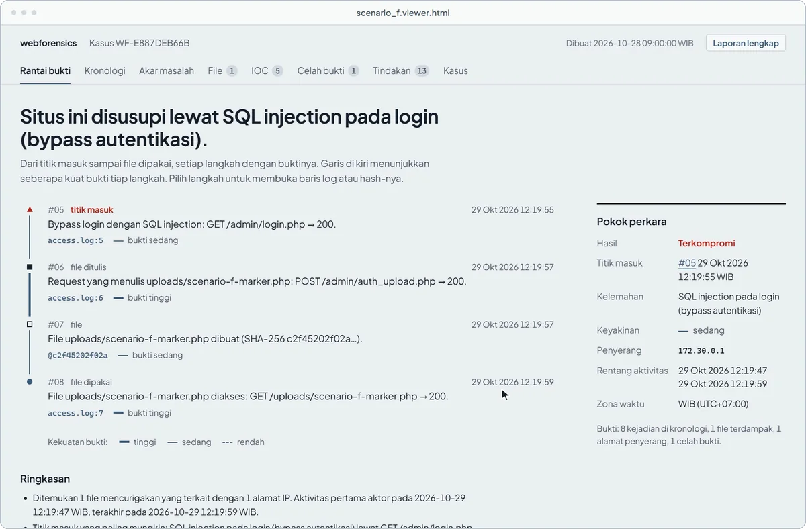
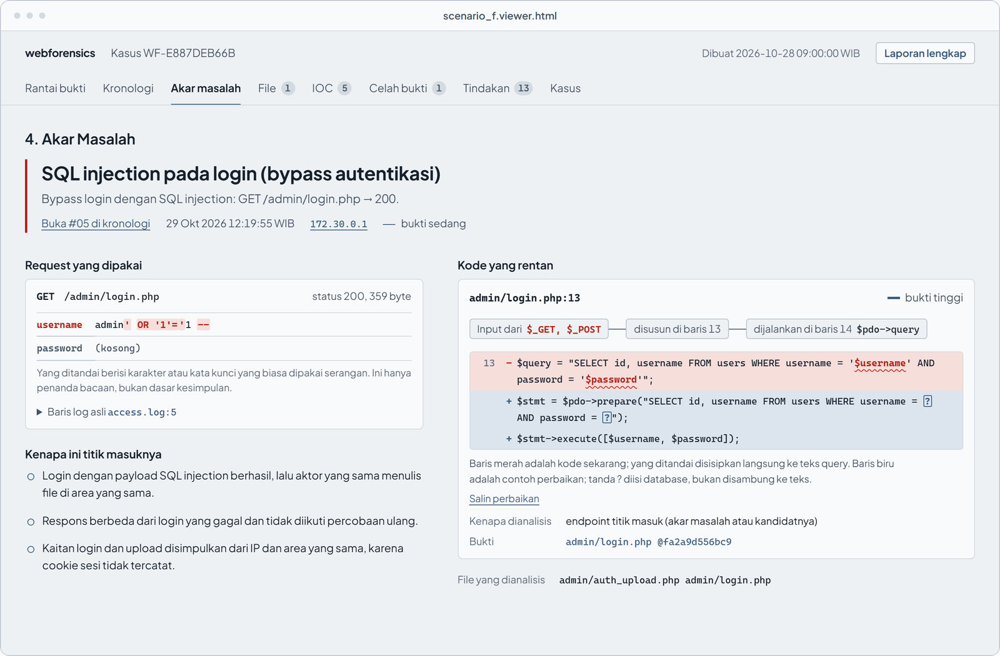
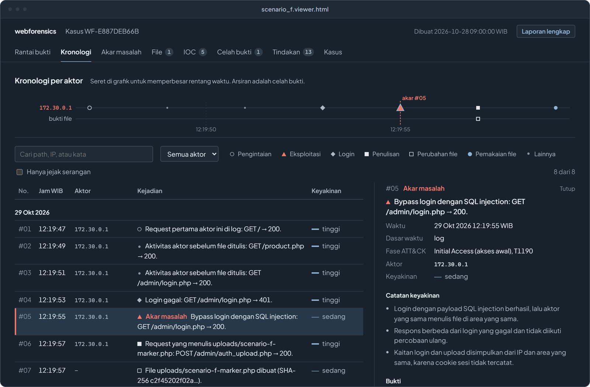

# webforensics

[](https://github.com/dhio0/webforensics/actions/workflows/ci.yml) [](CHANGELOG.md) [](LICENSE)

Reconstructs how a website was compromised. Given the web server's access logs and a snapshot of its webroot, it starts from the suspicious file the way an analyst does, finds the request that wrote it, and walks back to the way the attacker got in. Every conclusion cites a log line or a file hash. The output is an incident report in Indonesian, following a CSIRT incident-handling flow, and an offline viewer for exploring the case.

<a href="docs/media/viewer-demo.mp4"></a>

<sub>Lab scenario F: a SQL-injection login bypass, an upload, and one request to the uploaded file. [Watch as video (MP4)](docs/media/viewer-demo.mp4), or open the page itself offline: [docs/examples/scenario_f.viewer.html](docs/examples/scenario_f.viewer.html).</sub>

## What it does

- **File first.** For each new or changed file it picks the most trustworthy write time (btime or ctime before the easily forged mtime), ranks the requests around it by whether they could write a file, and follows the writer back to a login, an exploited endpoint or an unauthenticated upload. Scripts that were used and then deleted are found from the log alone.
- **Says what it cannot see.** Evidence gaps, unreadable log lines, timestamps that may be forged and logins whose method is not visible lower the confidence and are named in the report. When most of a log cannot be read, the summary says so first instead of "nothing found". An accused file is labelled by how strongly the evidence says it is the attacker's, not only by how sure its write time is; the labels are checked against the answer keys ([results](docs/results.md#do-the-confidence-labels-mean-anything)).
- **Knows the local threat.** Online gambling (judol) spam pages, the most common compromise of Indonesian public-sector sites, are flagged by their selling words, so news about judol is not: 34 of 35 real injected go.id pages found, and none of 11 unseen news and research pages about judol flagged. Search-engine cloaking and sites created through a hosting panel by a new address are reported as leads ([D98](docs/decisions.md)).
- **Points at the code.** With the webroot content, it names the vulnerable PHP line of an SQL injection and shows a prepared-statement fix.
- **Fits a SOC.** Evidence can come from plain files or from the Wazuh indexer (web logs plus FIM); a Wazuh integration can start an analysis on a FIM or web-attack alert and send the findings back as Wazuh alerts ([docs/wazuh.md](docs/wazuh.md)).
- **Deterministic and offline.** Rules and heuristics only, no network and no LLM in the analysis. The same evidence always gives the same bytes.

## Quick start

Install (Python 3.11 or newer):

```bash
pipx install git+https://github.com/dhio0/webforensics.git
# a fixed release:  pipx install git+https://github.com/dhio0/webforensics.git@v0.1.0
# or, without pipx:  pip install git+https://github.com/dhio0/webforensics.git
```

Then:

```bash
# On the compromised server (read-only; bash and GNU coreutils):
scripts/collect.sh -w /var/www/html -o /tmp/case01 -l /var/log/nginx

# On the analyst machine:
webforensics inspect --manifest case01/manifest.tsv --log case01/logs   # what was parsed
webforensics analyze --manifest case01/manifest.tsv --log case01/logs --out case01/report
webforensics view case01/report/report.json                            # viewer.html
```

- `analyze` writes `report.md`, `report.html` and `report.json`; `view` writes `viewer.html`, which opens offline in any browser.
- Useful options: `--baseline` (a known-good manifest), `--webroot` (file content for the code checks), `--error-log`, `--trusted-proxy`, `--log-format apache_combined`.
- The collector is [scripts/collect.sh](scripts/collect.sh); the evidence formats are in [docs/evidence-format.md](docs/evidence-format.md).
- To try it without a server, analyze a lab case from a clone of this repository:
  `webforensics analyze --log benchmark/scenarios/f/evidence/access.log --manifest benchmark/scenarios/f/evidence/manifest.tsv --out try`

## The viewer

One self-contained HTML page per case; it loads nothing from anywhere (its Content-Security-Policy allows only its own script, by hash, and no network).

- **Chain of evidence.** The verdict in one sentence, then each step from the entry point to the use of the attacker's file, with the log line or hash it rests on. The line joining the steps shows how strong each step's evidence is: thick for high, thin for medium, dashed for low.
- **The raw line, taken apart.** Each cited log line is split into client, time, method, path, query, status, size and user agent; pointing at a field marks it in the raw line. Query parameters are decoded, with attack syntax marked.
- **Root cause, worked through.** The request the attacker used, why it is the entry point, and the vulnerable PHP line next to its prepared-statement fix, with the variables put straight into the query marked.
- **Everything links to the timeline.** A file opens the events that wrote and used it, an IOC filters the timeline by that address or value (and copies for a SIEM or firewall), an evidence gap zooms the chart to its time range. Recommended actions are a checklist kept in the browser.
- **The full report in one click.** "Laporan lengkap" opens the whole report in a new tab, ready to print or save as PDF.
- **A timeline per actor.** One lane per actor and one shape per kind of event, evidence gaps hatched, the root cause marked; drag to zoom. Scanner bursts collapse into one row.
- **Keyboard.** `j` / `k` step through events, `/` searches events and cited lines, `1` to `8` switch sections. `#timeline:12` links to one event.

The text is the report's own Indonesian text, produced by the same code, and it works in light and dark mode and at phone width.





## How well it works

Each outside case was untouched, with its answer key written before the first run. First runs are the honest numbers; "after fixes" is post-hoc, and every fix is a general rule with its own test. Details and every table: [docs/results.md](docs/results.md).

| Evaluation | First run | After fixes |
|---|---|---|
| Lab, 5 scenarios, files and Wazuh | D failed (an admin's upload blamed) | 5/5 through both paths |
| Benchmark v2, 4 held-out scenarios | 1/4 fully correct | 2/4, fixes made from the dev scenarios only |
| Benchmark v2, 8 dev scenarios | 2/8 | 6/8 |
| Ali Hadi web server (Windows, XAMPP) | 10 false files | 0 false files, 4 deleted shells found, the SQLi line found; root cause only lenient |
| Ali Hadi Linux server (Drupalgeddon2) | exploit missed, wrong root cause, 3 false accusations | correct, nothing false |
| BND 2016 (log cut by the attacker) | compromise missed | defacement and the log gap found; no root cause claimed |
| Two public-sector servers, 7.6M lines | nothing false; incident missed; out of memory | 7.4M lines in one run, 3.7 min; incident still missed |
| BTLO Compromised WordPress | crash | the shell, its removal and the upload request found; nothing false |

No false accusation remains in any of them. Benchmark v2 is twelve scenarios on real applications (WordPress, phpMyFAQ, DVWA) attacked with real tools (sqlmap, Weevely, commix, Hydra), recorded separately from the tool, with the scoring rules written down before each run ([benchmark/v2](benchmark/v2/README.md)).

Damaged evidence was tested too: 10,000 seeded copies of real logs and manifests (lines out of order, error lines mixed in, broken UTF-8, gzip cut short) run without an error, and the suite checks on every run that cited lines are the lines they name and that shuffling a log changes no accusation.

## Limits

- **It needs a file or a log-only script to start from.** Attacks that write nothing, such as reading files through a path traversal or stealing data through SQL injection, are listed as attack activity but not reconstructed.
- **Access logs do not record POST bodies.** A payload in a body, and the name of an uploaded file, are not visible.
- **A login with valid credentials looks like the owner's.** An administrator installing a new plugin and an attacker doing the same look alike in a log.
- **One address can be many people** behind a proxy or NAT unless `--trusted-proxy` is given.
- **SQL injection only** for the code check, within one file and function.

## Documentation

| | |
|---|---|
| [How it works](docs/how-it-works.md) | the pipeline, with one case traced step by step |
| [Results](docs/results.md) | every evaluation, first runs and post-hoc runs |
| [Detection rules](docs/rules.md) | each rule, what it does not prove, false positives seen |
| [Decisions](docs/decisions.md) | design decisions and their reasons |
| [Wazuh](docs/wazuh.md) | pull, automatic trigger and write-back |
| [Evidence formats](docs/evidence-format.md) | the manifest and the supported log formats |
| [Benchmark](benchmark/README.md) | scenario format, and how to score another tool |
| [Plan](docs/plan.md) | data models, correlation algorithm, milestones |
| [Changelog](CHANGELOG.md) | what each release contains |

## Development

```bash
git clone https://github.com/dhio0/webforensics.git && cd webforensics
python -m venv .venv && .venv/bin/pip install -e ".[dev]"   # Windows: .venv\Scripts\pip
pytest -m "not lab"     # the lab tests need the Docker lab
ruff check .
```

## License

MIT, see [LICENSE](LICENSE). Third-party code used as test fixtures keeps its own license; each fixture states its source and license.
