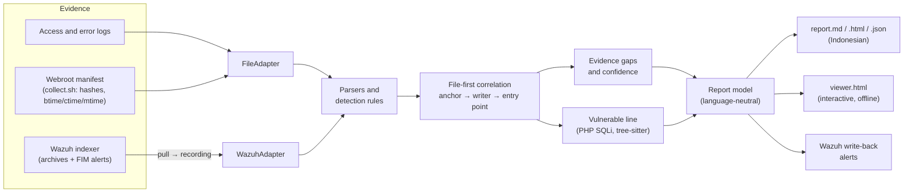

# How it works

webforensics answers the questions an admin asks after a website is hacked: *how did they get in, when, what did they change?* It does what a human analyst does by hand, in the same order: start from the suspicious file, read its timestamps, find the request that wrote it, then walk back to the exploit that made that request possible.

This page explains the pipeline, then traces one lab case through it step by step. The full algorithm and its known weaknesses are in [plan.md §4](plan.md); each design choice has a numbered decision in [decisions.md](decisions.md).

## The pipeline

- **Adapters** turn each evidence source into the same objects (`LogEvent`, `FileEvidence`), so everything after them is shared. Wazuh evidence is first copied into a recording, so analysis stays offline and reproducible (D78).
- **Rules** flag requests (SQL injection, code injection, traversal, scanners, brute force) and files (scripts in writable folders, dangerous functions fed by request input, defacement). A rule hit is a lead, not a verdict.
- **Correlation** is the core. It is deterministic: no LLM, no network, the same input gives the same bytes.
- **The report model** holds keys and parameters, not sentences. Markdown, HTML, JSON, the viewer and the Wazuh events are all rendered from it, so they always state the same facts.

## The correlation, in eight steps

1. **Normalize.** Parse every log line, keeping file and line number; convert times to UTC; hash every file; compare with a known-good baseline when one is given.
2. **Seed.** Files that the file rules flag become seeds: the places to start from.
3. **Anchor time.** For each seed, choose the most trustworthy write time: btime or ctime (which `touch` cannot set) before mtime (which it can). If mtime disagrees with ctime, raise a timestomping finding. With mtime alone, confidence is capped at medium. With Wazuh, a realtime FIM alert gives an upper bound on the write time.
4. **Invocations.** Map the file to its URL and find the requests that used it. The first one is "first use"; a use before the anchor means the anchor is wrong.
5. **Writer.** Look for requests in a window just before the anchor (default 120 s, with 5 s of clock slack). Rank them by fixed rules: can this request write files (upload endpoint, PUT, `INTO OUTFILE`), did it succeed, is it the same actor that later used the file, how close in time. Close runners-up are kept as alternatives, not hidden.
6. **Entry point.** Walk back through that actor's earlier requests to the earliest successful exploit the write depends on, for example a SQL-injection login bypass before an authenticated upload. Reconnaissance is context, not the root cause. If the writing request is itself the exploit (an unauthenticated upload), it is the root cause.
7. **Forward.** List what the actor did next: requests to the webshell, more files, `.htaccess` changes.
8. **Gaps and confidence.** Find what the evidence cannot show (silences in the log, no baseline, POST bodies not logged, a log that starts after the files changed) and lower the confidence of the claims each gap weakens. A file's label is the lower of two things: how sure its write time is, and how strongly the evidence says it is the attacker's. High needs content that proves attacker code (for example code that runs request input) and an HTTP link to it (an upload-like writer, a rarely hit POST target, a suspicious use); content or a link alone gives medium; path, timing or baseline alone gives low. A root cause is never surer than the file it led to (D100). Then map to MITRE ATT&CK and emit the report.

Every timeline row cites its evidence: a log file and line number, or a file path and SHA-256.

## One case, traced: lab scenario F

Scenario F is a small lab attack: a failed login, a SQL-injection login bypass, an authenticated upload of a PHP file, and one request to that file. The evidence is a 7-line access log and a webroot manifest. Times below are WIB (UTC+7), as in the report.

| # | Time | Evidence | What the tool concludes |
|---|---|---|---|
| 1 | 12:19:47 | `access.log:1` | First request of 172.30.0.1: `GET /` → 200 |
| 2 | 12:19:53 | `access.log:4` | Failed login: `GET /admin/login.php` → 401 |
| 3 | 12:19:55 | `access.log:5` | **Root cause:** SQL-injection login bypass, `GET /admin/login.php` → 200 (Initial Access, T1190) |
| 4 | 12:19:57 | `access.log:6` + file hash | The request that wrote the file: `POST /admin/auth_upload.php` → 200 |
| 5 | 12:19:57 | `uploads/scenario-f-marker.php @c2f45202f02a` | The file was born (btime) |
| 6 | 12:19:59 | `access.log:7` | The file was used: `GET /uploads/scenario-f-marker.php` → 200 (Persistence, T1505.003) |

How it got there, following the steps above:

- **Seed (step 2).** `uploads/scenario-f-marker.php` is a script in a writable upload folder (`FILE-WEBSHELL-WRITABLE-EXEC`).
- **Anchor (step 3).** The manifest has a btime, 12:19:57. btime cannot be set with `touch`, so the anchor is trusted.
- **Invocation (step 4).** The only request to the file's URL is line 7, two seconds after its birth, from 172.30.0.1.
- **Writer (step 5).** In the 120 s before the anchor, the request that can write files is the POST to the upload endpoint `/admin/auth_upload.php` (line 6), from the same IP that later used the file, answered 200.
- **Entry point (step 6).** The upload sits in the same `/admin/` area as the login. Walking back through 172.30.0.1's requests: a failed login (line 4), then a login whose query string holds a SQL tautology, answered 200 with a different response than the failed one and not followed by more attempts (line 5). That is the earliest successful exploit before the write.
- **Gaps (step 8).** There is no baseline, so the file's "new" status comes from heuristics, and the report says so. The link between the login and the upload is inferred from the IP and timing, because the session cookie is not logged. That is why the root cause is **medium** confidence while the writer is **high**. The file itself is **medium** too: the lab marker is inert on purpose, so nothing in its content proves attacker code; only the upload and the use link it to the attack (D100).
- **Vulnerable line.** Given the webroot, the code check parses `admin/login.php`, follows `$_GET`/`$_POST` into the query string on line 13, executed on line 14, and suggests a prepared statement.

The same case in the [interactive viewer](examples/scenario_f.viewer.html), or as the static report: [scenario_f.md](../tests/golden/scenario_f.md).

## What it cannot see

These limits are stated in every report rather than hidden:

- **POST bodies are not in access logs.** An upload's file name or a SQL injection in a form field is invisible. The link is then inferred from timing and endpoint, and confidence drops.
- **mtime can be forged.** ctime and btime are much harder to change, but root can still change the clock. The tool detects inconsistency; it cannot prove integrity.
- **Deleted or cut logs.** If the exploit request is gone, the entry point is reported as unknown. The tool does not invent one.
- **Shared IPs.** NAT, proxies or a CDN without `X-Forwarded-For` make actors ambiguous; the tool then lists alternatives.
- **Non-HTTP entry.** A file dropped over SSH, FTP or a deploy has no malicious request. The report says "no HTTP creation request found".

How well this works is measured, not assumed: see [evaluation.md](evaluation.md) for the lab benchmark and the outside cases, each scored against an answer key written before the run.
